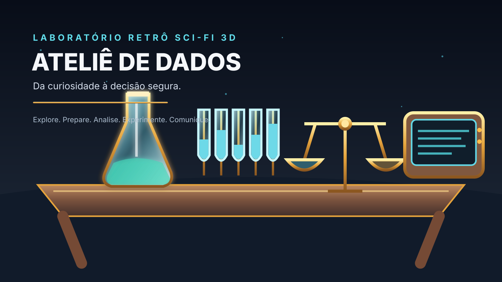

<!--
  Ateliê de Dados — README
  Projeto educacional aberto. Dados e cenários são sintéticos.
-->

<div align="center">
  

  <h1>Ateliê de Dados</h1>
  <p><strong>Da curiosidade à decisão segura.</strong></p>
  <p>Um laboratório retrô sci-fi em 3D para aprender fundamentos de análise de dados por exploração, experimentação e desafios interativos.</p>

  <p>
    <a href="https://enps2015.github.io/atiliedosdados-eric/"><strong>🚀 Abrir o laboratório</strong></a>
    ·
    <a href="#como-explorar">Como explorar</a>
    ·
    <a href="#executar-localmente">Executar localmente</a>
    ·
    <a href="#sobre-a-origem">Origem do projeto</a>
  </p>

  <p>
    
    
    
    
    
    
  </p>
</div>

---

## ✨ Visão geral

O **Ateliê de Dados** é uma experiência educacional interativa que transforma conceitos de análise de dados em uma jornada por um laboratório tridimensional. Em vez de começar por fórmulas ou código, a pessoa explora instrumentos virtuais, observa problemas em conjuntos de dados e experimenta como decisões de preparação e análise modificam os resultados.

A proposta é tornar a cultura de dados mais acessível a estudantes, educadores, profissionais e pessoas curiosas de qualquer área — mesmo para quem nunca programou.

> **Atenção — ambiente didático:** todos os registros dos três cenários são **sintéticos e simulados**. Eles foram criados para ensinar conceitos e não representam medições de campo, estudos científicos ou dados operacionais reais. Resultados e recomendações são exemplos de interpretação, não evidências empíricas nem orientações profissionais.

## 🧭 O que você encontra no laboratório

### Uma jornada em seis etapas

| Etapa | Estação | Conceitos trabalhados |
|---|---|---|
| 01 | Coleta & origem | Dados brutos, inspeção inicial, estrutura e procedência |
| 02 | Limpeza & preparação | Valores ausentes, duplicidades, outliers e padronização de escalas |
| 03 | Exploração & comparação | Estatística descritiva, média, mediana e influência de extremos |
| 04 | Transformação & relações | Correlação, tendências, agrupamentos e variáveis contextuais |
| 05 | Modelagem & previsão | Regressão linear, simulação de cenários e sensibilidade do modelo |
| 06 | Comunicação & decisão | Interpretação, síntese de resultados e comunicação responsável |

### Três cenários para aprender fazendo

- **☕ O Mistério da Cafeteria Congelada** — investigar registros de vendas, valores extremos, movimento e possíveis gargalos em uma cafeteria fictícia.
- **🌙 O Enigma das Noites em Claro** — explorar um conjunto simulado sobre sono e desempenho acadêmico, discutindo associações sem confundi-las com causalidade.
- **🚲 O Caso das Bicicletas Fantasmas** — analisar registros simulados de mobilidade, chuva, viagens e ocupação de estações.

Os cenários usam contextos cotidianos para demonstrar que análise de dados não é uma atividade restrita a cientistas de dados: é uma forma estruturada de investigar perguntas e apoiar decisões.

### Modos de aprendizagem

- **Guia passo a passo:** percurso sequencial com instruções e desbloqueio progressivo das estações.
- **Bancada completa:** exploração livre dos instrumentos e dos controles disponíveis.
- **Desafios:** perguntas e tarefas práticas para verificar a compreensão.
- **Glossário 3D:** consulta contextual de conceitos e instrumentos.
- **Terminal CRT:** sínteses didáticas e leituras dos resultados em uma interface retrô.

## 🎯 Objetivos educacionais

Ao explorar o laboratório, a pessoa é convidada a:

1. Reconhecer que dados brutos podem conter erros, lacunas, duplicidades e valores extremos.
2. Entender por que a preparação dos dados deve anteceder análises e modelos.
3. Comparar medidas de tendência central e perceber a influência de outliers.
4. Interpretar correlação, regressão e agrupamentos com senso crítico.
5. Experimentar cenários e observar como mudanças nas entradas afetam resultados.
6. Comunicar conclusões com contexto, limites e cautela.

O projeto não pretende substituir disciplinas, livros, ferramentas profissionais ou análises reproduzíveis. Seu papel é funcionar como uma **porta de entrada visual e interativa** para esses assuntos.

## 🧪 Como explorar

1. Acesse o [Ateliê de Dados](https://enps2015.github.io/atiliedosdados-eric/).
2. Leia a apresentação inicial e selecione **Iniciar Jornada na Etapa 01**.
3. Inspecione o lote de dados brutos no primeiro instrumento.
4. Siga as orientações do painel lateral e avance pelas estações.
5. Experimente os controles de limpeza, comparação e simulação.
6. Repita a exploração nos cenários **Sono & Notas** e **Bicicletas**.
7. Visite os desafios e o glossário para consolidar os conceitos.

**Dica:** não se limite a clicar nos controles. Antes de alterar uma variável, formule uma hipótese: *o que espero que aconteça e por quê?* Depois compare sua previsão com o resultado apresentado.

## 🧱 Stack tecnológica

O projeto é uma aplicação web client-side construída com React e TypeScript, empacotada pelo Vite e com uma cena 3D renderizada usando Three.js.

| Tecnologia | Papel no projeto |
|---|---|
| **React 19** | Composição da interface em componentes e gerenciamento do estado da experiência |
| **TypeScript 7** | Tipagem estática dos dados, estados, cenários e contratos entre módulos |
| **Vite 8** | Servidor de desenvolvimento e build otimizado para produção |
| **Three.js 0.187** | Renderização WebGL da bancada, instrumentos e elementos tridimensionais |
| **Tailwind CSS 4** | Estilização e composição visual da interface |
| **Motion** | Recursos de animação e transições da interface |
| **Lucide React** | Ícones da interface |
| **Web Audio API** | Efeitos sonoros gerados proceduralmente no navegador |
| **Bun** | Instalação de dependências, execução de scripts e build reproduzível |
| **GitHub Actions** | Automação de validação, build e publicação |
| **GitHub Pages** | Hospedagem estática da aplicação |

### Arquitetura em alto nível

```text
Navegador
└── React Application
    ├── Interface e navegação
    │   ├── TopBar
    │   ├── ContextDrawer
    │   ├── BottomDock
    │   └── StoryIntroModal
    ├── Experiência 3D
    │   ├── LabViewport3D
    │   ├── Instruments
    │   └── Textures
    ├── Conteúdo didático
    │   ├── Scenarios
    │   └── Glossary
    ├── Motor analítico
    │   ├── Analytics
    │   └── Didactic Report
    └── Recursos do navegador
        └── Procedural Audio
```

### Organização do código

| Caminho | Responsabilidade |
|---|---|
| `src/App.tsx` | Estado global da jornada, navegação, cenários e progressão |
| `src/components/` | Componentes de interface e integração da experiência |
| `src/scene/instruments.ts` | Construção dos instrumentos e elementos da cena 3D |
| `src/scene/textures.ts` | Materiais e texturas da cena |
| `src/data/scenarios.ts` | Conjuntos de dados e narrativas dos cenários |
| `src/data/glossary.ts` | Conteúdo do glossário |
| `src/engine/analytics.ts` | Cálculos e estatísticas usados na experiência |
| `src/engine/report.ts` | Geração das sínteses e interpretações didáticas |
| `src/types/lab.ts` | Tipos e contratos centrais do domínio |
| `src/utils/sound.ts` | Sonorização procedural |
| `vite.config.ts` | Configuração do Vite e caminho-base de publicação |

## 🧠 Origem do projeto

O projeto nasceu da curiosidade em experimentar a **Hydrogen, ferramenta de IA do Google AI Studio**, e investigar até onde seria possível levar uma aplicação com experiência tridimensional.

O primeiro impulso não foi criar um produto educacional completo. Foi experimentar uma tecnologia nova, testar possibilidades e construir algo em 3D. Durante essa exploração surgiu a ideia: **e se esse ambiente se transformasse em um laboratório onde qualquer pessoa pudesse aprender as etapas de uma pipeline de dados?**

A partir dessa pergunta, o experimento ganhou propósito educacional. Os instrumentos do laboratório passaram a representar operações e conceitos de análise de dados; os cenários passaram a oferecer problemas contextualizados; e a jornada em seis etapas organizou a aprendizagem.

O projeto representa, portanto, um processo de experimentação tecnológica convertido em um recurso aberto de aprendizagem.

### Da experimentação à publicação

- Exploração da Hydrogen no Google AI Studio.
- Prototipação de uma experiência tridimensional.
- Definição da metáfora do laboratório e das estações.
- Criação de cenários sintéticos e desafios educacionais.
- Refinamento de interface, conteúdo e interpretação estatística.
- Preparação de build e publicação automatizada com GitHub Actions e GitHub Pages.

**Importante:** a Hydrogen faz parte da história de origem e experimentação do projeto. A aplicação publicada atualmente não depende de uma chamada à Hydrogen ou a uma API de IA para funcionar.

## 🔍 Decisões técnicas, auditoria e correções

Durante o refinamento do repositório foram identificados pontos que poderiam comprometer a publicação ou transmitir interpretações incorretas. A tabela registra os principais achados e o tratamento dado.

| Achado | Risco | Tratamento / situação |
|---|---|---|
| Caminhos absolutos de assets e ausência de caminho-base do GitHub Pages | Arquivos poderiam não carregar quando a aplicação fosse publicada em um subdiretório | Configurado `base` no Vite e uso de `BASE_URL` nos assets revisados |
| Ausência de workflow de publicação próprio | Deploy manual e maior chance de divergência entre build e publicação | Criado workflow GitHub Actions para instalar, validar, compilar e publicar `dist` |
| Cenários descritos como casos reais | Usuário poderia interpretar dados simulados como evidência empírica | Narrativas e documentação passaram a identificar os cenários como simulados |
| Linguagem que sugeria causalidade | Correlação poderia ser confundida com causa e efeito | Textos revisados para explicitar associação, contexto e limites de interpretação |
| Indicador de etapas aplicadas confundido com qualidade global | Percentual poderia parecer certificação de qualidade dos dados | Relatórios revisados para distinguir filtros ativados de qualidade ou ausência de vieses |
| Valores ausentes representados como zero em demonstração | A simulação poderia ser interpretada como recomendação de imputação | Incluída ressalva didática explícita: zero é uma demonstração de tratamento inadequado, não uma recomendação |
| Dependências e identidade herdadas de template | Metadados pouco claros para manutenção | Nome do pacote atualizado para `atelie-dos-dados` e lockfile sincronizado |

### Pontos de atenção ainda relevantes

- A nomenclatura de alguns indicadores exibidos no monitor CRT deve permanecer coerente com a distinção entre **etapas aplicadas**, **qualidade dos dados** e **métricas do ajuste**. A interface deve ser conferida sempre que textos de relatório forem alterados.
- O manifesto de dependências contém pacotes como `@google/genai`, `express` e `dotenv`. Eles não são necessários para o fluxo client-side descrito e não devem ser interpretados como prova de que a versão publicada utiliza backend ou chamadas Gemini. Uma limpeza de dependências pode ser feita após verificar todos os imports e necessidades do ambiente de desenvolvimento.
- O projeto possui validação TypeScript e build de produção automatizados. Isso não equivale a uma suíte completa de testes unitários, testes de integração ou testes automatizados de navegador.
- O comportamento WebGL pode variar entre navegadores, GPUs e dispositivos. A experiência deve ser validada em telas menores e hardware de menor capacidade.

## ⚙️ Executar localmente

### Pré-requisitos

- Git
- [Bun](https://bun.sh/) instalado
- Navegador moderno com suporte a WebGL

### Instalação

```bash
git clone https://github.com/enps2015/atiliedosdados-eric.git
cd atiliedosdados-eric

bun install --frozen-lockfile
bun run dev
```

O Vite disponibiliza o servidor local na porta **3000**. Acesse:

```text
http://localhost:3000
```

### Scripts disponíveis

| Comando | Finalidade |
|---|---|
| `bun run dev` | Inicia o servidor de desenvolvimento |
| `bun run lint` | Executa a verificação de tipos TypeScript (`tsc --noEmit`) |
| `bun run build` | Gera a versão de produção em `dist/` |
| `bun run preview` | Serve localmente o build de produção |
| `bun run clean` | Remove artefatos locais de build e o arquivo `server.js`, se existir |

### Build para GitHub Pages

O repositório é publicado em um subdiretório do domínio `github.io`. Por isso, o caminho-base precisa ser informado:

```bash
VITE_BASE_PATH=/atiliedosdados-eric/ bun run build
bun run preview
```

Para hospedar em outro domínio ou na raiz de um domínio, ajuste `VITE_BASE_PATH` de acordo com o destino.

## 🚀 Integração contínua e deploy

O workflow `.github/workflows/deploy.yml` é acionado em:

- Push para a branch `main`.
- Execução manual pelo GitHub Actions (`workflow_dispatch`).

O pipeline automatizado executa:

1. Checkout do código.
2. Configuração do Bun.
3. Instalação reprodutível com `bun install --frozen-lockfile`.
4. Verificação de tipos com `bun run lint`.
5. Build de produção com o caminho-base do GitHub Pages.
6. Upload do diretório `dist` como artefato do Pages.
7. Deploy do artefato no GitHub Pages.

### Configuração necessária no GitHub

Em **Settings → Pages → Build and deployment → Source**, selecione **GitHub Actions**. O workflow próprio do projeto deve ser a fonte responsável pela publicação.

- [Workflow de deploy](https://github.com/enps2015/atiliedosdados-eric/actions/workflows/deploy.yml)
- [Configurações do GitHub Pages](https://github.com/enps2015/atiliedosdados-eric/settings/pages)
- [Histórico de commits](https://github.com/enps2015/atiliedosdados-eric/commits/main)

## 🔐 Segurança, privacidade e dados

- A experiência atual é executada no navegador e não exige cadastro para ser explorada.
- Não é necessária uma chave de API Gemini para utilizar a versão publicada.
- Os cenários incluídos são sintéticos; não insira dados pessoais ou sensíveis em forks ou extensões do projeto sem antes avaliar privacidade e segurança.
- O repositório inclui uma política básica em [SECURITY.md](SECURITY.md).
- Não foram identificados serviços de backend necessários ao fluxo principal da aplicação durante a revisão do código.

## 📚 Limites pedagógicos e estatísticos

O laboratório é uma introdução visual, não um ambiente de análise estatística de uso profissional. Algumas ressalvas são essenciais:

- **Correlação não implica causalidade.** Uma associação pode decorrer de variáveis contextuais, viés de seleção, confundimento ou acaso.
- **R² não é uma nota universal de qualidade.** Ele resume a proporção da variação da variável resposta explicada pelo ajuste linear no conjunto analisado; não garante causalidade nem desempenho fora da amostra.
- **Limpeza não é certificação.** Ativar filtros didáticos não prova que todos os problemas foram resolvidos.
- **Dados sintéticos não validam decisões reais.** Recomendações dos cenários são hipóteses para discussão e precisariam de dados adequados, contexto e validação antes de qualquer uso operacional.

## 🗺️ Próximos passos

O desenvolvimento pode evoluir de forma incremental, priorizando confiabilidade e aprendizagem:

- [ ] Conferir a nomenclatura de todos os indicadores e painéis CRT.
- [ ] Revisar dependências não utilizadas após auditoria de imports e do ambiente de build.
- [ ] Adicionar testes automatizados para cálculos estatísticos e regras de progressão.
- [ ] Realizar testes de interface em navegadores e dispositivos móveis.
- [ ] Documentar controles de câmera, áudio e acessibilidade.
- [ ] Incorporar capturas de tela otimizadas ao README para demonstrar os três cenários e os modos de aprendizagem.

Sugestões e relatos de problemas são bem-vindos por meio das [Issues do repositório](https://github.com/enps2015/atiliedosdados-eric/issues).

## 👨‍💻 Autor

**Eric Pimentel**  
Embaixador Estudantil Google Brasil 2026  
Belém — Pará — Brasil

- GitHub: [@enps2015](https://github.com/enps2015)
- LinkedIn: [Eric Pimentel](https://www.linkedin.com/in/eric-np-santos/)
- Instagram: [@eric.n.pimentel](https://www.instagram.com/eric.n.pimentel/)

## 📄 Licença

**Licença ainda não especificada.** Até que uma licença seja adicionada ao repositório, não presuma que o código ou os assets estejam liberados para redistribuição, modificação ou uso comercial. Consulte o autor antes de reutilizar o material.

---

<div align="center">
  <p><strong>Curiosidade para explorar. Dados para questionar. Conhecimento para compartilhar.</strong></p>
  <sub>Ateliê de Dados · Projeto educacional independente · 2026</sub>
</div>
